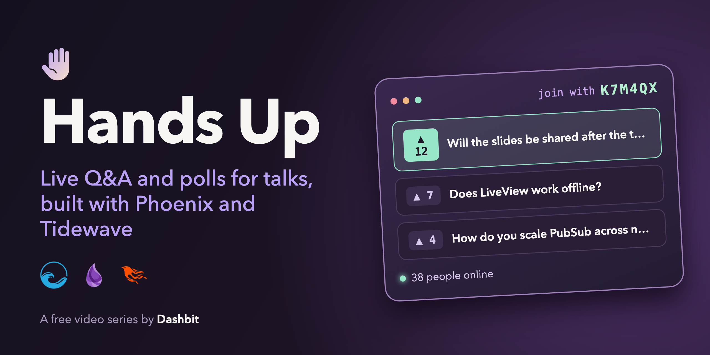

# Hands Up

Live Q&A and polls for talks, meetups and workshops. The speaker creates an event, the audience joins
from their phones with a short code, sends questions and upvotes the best ones, and everything updates
in real time on a presenter screen. Later in the series come live polls, an online count and a
moderation queue.

Built with Elixir, Phoenix LiveView and Postgres. The real-time parts use only what ships with
Phoenix (LiveView, PubSub and Presence), with no separate real-time service.

## A free video series

This app is built from an empty folder in **Hands Up**, a free weekly series on the
[Dashbit YouTube channel](https://www.youtube.com/@dashbitco). Each episode adds one feature to the
app with a coding agent in [Tidewave](https://tidewave.ai/?utm_source=github&utm_medium=readme&utm_campaign=hands_up),
and the Tidewave features show up when that feature needs them: reading the docs for the exact versions
in `mix.lock`, reviewing the diff before the commit, checking the running app in the browser, and more.
Each episode uses a different model or agent.

[](https://www.youtube.com/playlist?list=PLZmBfYrC_fPQ)

The app grows with the episodes, so it is still a work in progress.

## Follow along with the tags

Each tag is the state of the project at the end of an episode, so you can start from where any
episode begins:

| Tag | Episode | What the app gains |
|---|---|---|
| [`ep-01`](https://github.com/danielbergholz/hands-up/tree/ep-01) | [01. Let's Build a Live Q&A App with Phoenix and AI](https://youtu.be/5YA_Mho86v8) | New Phoenix app with Tidewave, create an event, join it by code |

To see the project as it was at the end of an episode: `git checkout ep-01`.

## Running it

You need Elixir and Erlang, and Postgres running on `localhost` with the `postgres` user and password.

```bash
mix setup
mix phx.server
```

Open [localhost:4000](http://localhost:4000), create an event and join it from another tab with its
code. To work on it with Tidewave, see the [installation guide](https://tidewave.hexdocs.pm/installation.html).

Before any commit, `mix precommit` compiles, formats and runs the tests.
